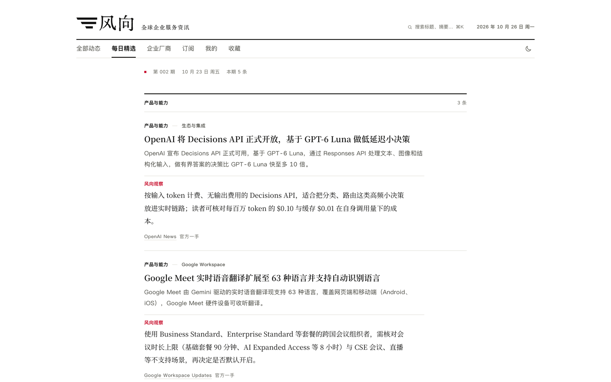
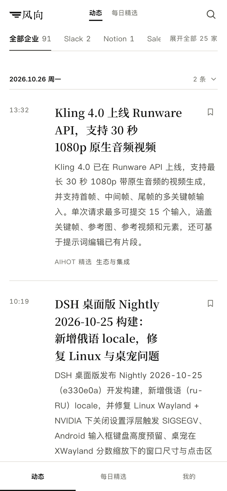
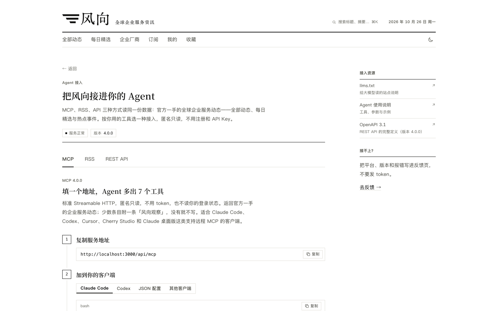

# 风向 (Fengxiang) · Global Enterprise Software and Services News

[简体中文](README.md) | English

<!-- Status: current · Last reviewed: October 29, 2026 -->

> A customizable information platform for individuals tracking topics they care about and businesses bringing together high-value sources.

Fengxiang follows developments in enterprise software and services worldwide, including AI products, agents, pricing changes and market expansion. It collects content from configured sources, generates Chinese headlines and summaries, presents updates chronologically, and compiles a daily edition called 每日精选.

Deploy the current configuration, or replace its sources, categories, prompts and branding to build a personal information site or a business-focused hub.

[Online preview](https://fightkk7.github.io/fengxiang/): a static demo of the interface and sample content. Live collection and API services require a running deployment.


The company directory brings together the updates collected for each company. Open a company page to browse its coverage, or filter the homepage by company.

## Content and reading

The repository includes official sources from OpenAI, Google Workspace, Salesforce, Slack and other companies. Each update retains its source and original link for reference. Some entries include a short observation labeled 风向观察.

### A curated daily edition



By default, an issue is published at 08:00 Beijing time each day. It presents a small selection of updates from the preceding 24 hours, organized by section. When no content meets the selection criteria, the issue says so.

### Chinese summaries and bilingual reading


Article pages begin with a Chinese headline, summary and source. Full text is available when retrieval succeeds and on-site display is permitted. Articles with generated translations support paragraph-by-paragraph comparison with the original. Other entries provide a link to the source.

Desktop reading tools include bookmarks, text sizing and a translation toggle. Bookmarks and reading preferences are stored in the current browser.

### Follow companies and topics

Browse the directory by company, topic and content type. Topic pages bring together related updates, a description, the number of entries in the past 30 days and recent activity.

### Mobile reading

<p align="center">
  
</p>

The mobile interface has three main sections: feed, daily edition and personal settings. It supports light and dark themes and bookmarks.

## Subscriptions and agent access



The website, RSS, public API and MCP use the same publication data. Public read access requires no account or API key.

- **RSS**: subscribe to updates or daily editions in a feed reader.
- **REST API**: query and retrieve content from your own programs, with an OpenAPI 3.1 specification.
- **MCP**: connect clients that support remote MCP. Seven tools cover recent updates, search, trending events, event details, daily editions, and weekly and monthly archives.

After deployment, visit `/agent` for endpoints, client configuration and usage examples.

Screenshots were taken from a local instance on October 26, 2026. The displayed content is not included in the repository.

## Build a personal or business information site

Individuals can follow the companies, topics and fields they care about. Businesses can bring together sources for tenders, sales leads, opportunities and customer-related information in a single feed. Available sources depend on their formats; non-standard sources can be added with a custom crawler.

Site and industry configuration are kept in dedicated directories:

| What to change | Location |
|---|---|
| Site name, copy, navigation and publication times | `app/site/site.ts` |
| Sources, categories, tags and topics | `app/industry/` |
| Prompts for summaries, selection and translation | `app/industry/prompts/` |
| Brand assets | `app/site/brand/` |

See the [customization guide](app/docs/customize.md) for details. The admin console also lets you manage sources, edit entries, arrange and publish editions, and review jobs, model usage and operation history.

## Quick start

Requirements: Node.js 24.11 or a later 24.x release, and Docker with Compose. Automatic content generation also needs an OpenAI-compatible model service.

**1. Get the code and generate configuration**

```bash
git clone https://github.com/FightKK7/fengxiang.git
cd fengxiang/app
node scripts/init-env.ts
```

The script creates `.env` with random secrets and an administrator password.

**2. Configure the model and runtime switches**

Set `LLM_API_KEY` in `.env`, and check `LLM_BASE_URL` and `LLM_MODEL`. The example uses DeepSeek; adjust the endpoint and model for your provider.

The example sets both `COLLECT_ENABLED` and `MODEL_CALLS_ENABLED` to `true`. Starting the worker with valid credentials enables collection and model calls, billed according to your provider's terms. Set both switches to `false` when working only on the interface.

**3. Start the services**

```bash
docker compose up -d --build
```

Open [http://localhost:3000](http://localhost:3000). The admin console is at `/admin`; sign in with `ADMIN_PASSWORD` from `.env`.

The first startup imports the bundled source configuration. Content appears as collection and processing jobs finish; daily editions follow the configured schedule. A new deployment does not contain the articles or past issues shown in the screenshots.

See the [deployment guide](app/docs/deploy.md) for domains, HTTPS, updates and backups.

## Development and documentation

The project uses Node.js, TypeScript, React Router with server-side rendering, Fastify, PostgreSQL 17 and pg-boss, with Docker Compose for deployment. Application code lives in `app/`.

- [Application development guide](app/README.en.md)
- [Architecture and database migrations](app/docs/architecture.md)
- [Source configuration and collection](app/docs/sources.md)
- [Selection rules and calibration](app/docs/selection.md)
- [Contributing guide](CONTRIBUTING.md) and [CI configuration](.github/workflows/check.yml)

Most detailed documentation is in Chinese.

## License and attribution

The code is released under the [MIT License](LICENSE). Fengxiang is based on the AIHOT framework and retains its copyright notices. See [NOTICE](NOTICE) for attribution and third-party materials. The Fengxiang name, site content and brand assets are outside the MIT license.

See [SECURITY.md](SECURITY.md) to report a security issue.
