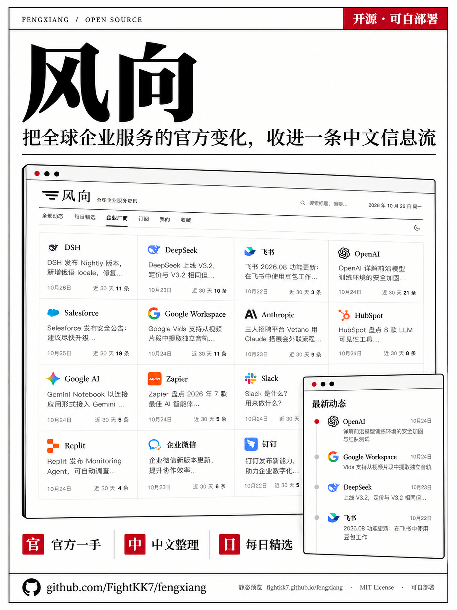
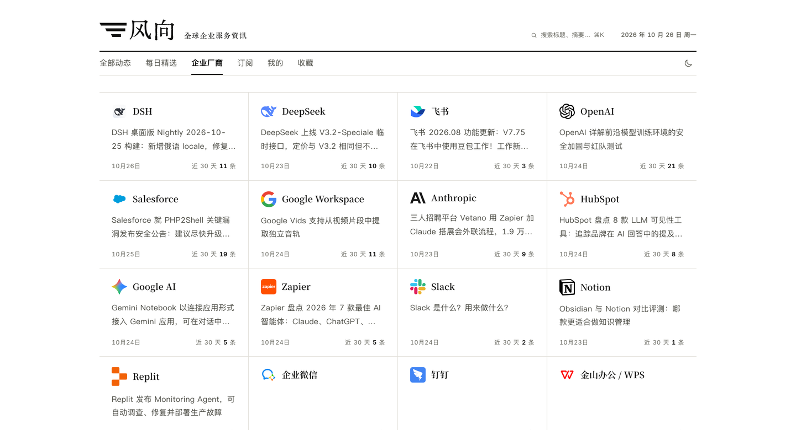
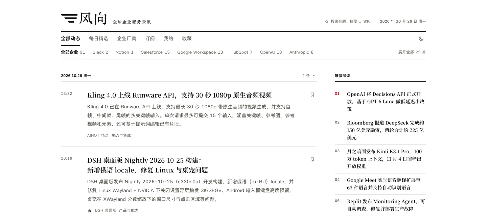
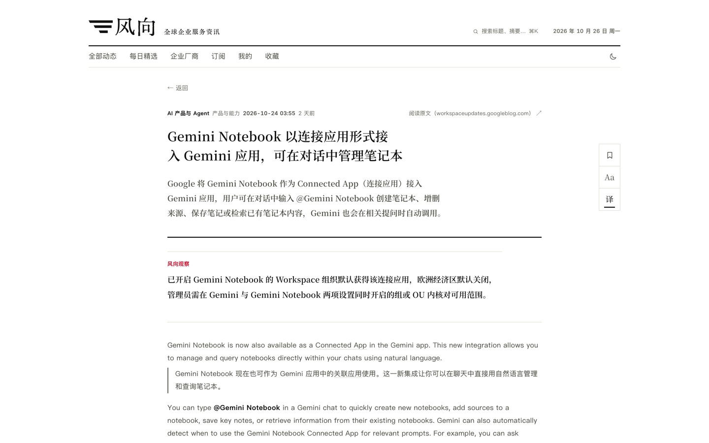

# 风向 · 全球企业服务资讯



简体中文 | [English](.github/README.en.md)

<!-- 状态：当前有效 · 最后核对：2026-10-29 -->

> 个人与企业，都能搭建自己的信息站。

个人可以持续关注自己感兴趣的公司、主题和领域；企业可以按业务需要汇总招投标、销售线索、商机和客户相关信息。风向当前示例聚合全球企业服务官方动态，整理成中文信息流与每日精选。

你可以直接部署当前版本，也可以更换信源、分类、提示词和品牌，搭建个人关注主题的信息站，或为企业业务汇总所需信息。

[在线预览](https://fightkk7.github.io/fengxiang/)：静态演示，用于浏览界面与示例内容；实时采集与接口服务需自行部署。



企业厂商目录汇总各公司的已收录动态，进入公司页可继续查看相关内容；首页也支持按厂商筛选。

## 页面预览

### 首页



首页按时间展示动态，支持按厂商筛选；右侧提供推荐阅读和订阅入口。

### 每日精选


默认每天 08:00（北京时间）出刊，从此前 24 小时的动态中选取少量条目，按栏目编排。当期没有符合精选标准的内容时，页面会明确说明。

### 中文摘要与原文对照



条目页先展示中文标题、摘要和出处。正文获取成功且允许站内展示时，可在站内阅读；已生成译文的文章支持原文与中文逐段对照。未获取正文或仅展示摘要的条目，提供原文入口。

桌面端提供收藏、字号调整和译文开关；收藏与阅读偏好保存在当前浏览器。

### 手机阅读

<p align="center">
  
</p>

手机端提供「动态」「每日精选」「我的」三个主要入口，支持深浅色切换与收藏。

### Agent 接入


网页、RSS、公开 API 和 MCP 共用同一套发布数据。公开读取无需注册或 API Key。

- **RSS**：在阅读器中订阅动态或每日精选。
- **REST API**：供程序读取和查询内容，附 OpenAPI 3.1 定义。
- **MCP**：供支持远程 MCP 的客户端接入，提供最新动态、搜索、热点、事件详情、每日精选，以及周报和月报归档共 7 个工具。

部署后访问 `/agent`，可查看接入地址、客户端配置和调用示例。

以上截图来自 2026 年 10 月 26 日的本地实例。截图中的内容仅用于展示，不随仓库分发。

## 信息如何整理与发布

从配置好的信源采集内容，经筛选与整理后形成中文信息流；入选内容还可编为每日精选。

- **按需接入信源**：支持 RSS、网页列表、JSON 接口、X 账号和外部推送，也可按来源定制抓取。默认示例预置 OpenAI、Google Workspace、Salesforce、Slack 等官方信源。
- **中文整理与原文核对**：内容整理为中文标题和摘要，并保留来源链接；正文允许站内展示时可阅读全文，已生成译文的文章支持中英逐段对照。
- **每日精选**：默认每天 08:00（北京时间）出刊，从此前 24 小时的动态中选取少量条目，按栏目编排；当期没有符合标准的内容时会明确说明。
- **网页与开放接口**：内容可通过网页、RSS、公开 API 和 MCP 阅读；公开读取无需注册或 API Key，MCP 提供 7 个工具。

## 个人与企业

个人可以跟进自己关注的公司与主题；企业可以接入招投标、销售线索、商机和客户相关信息，按业务分类整理。常见信源可直接配置，非标准来源可定制抓取或通过外部推送接入。

| 用途 | 适合的内容 |
|---|---|
| 个人 | 关注的公司、主题与领域 |
| 企业 | 招投标、线索、商机与客户相关信息 |
| 信源 | RSS、网页、JSON、定制抓取 |
| 阅读 | 时间线、每日精选、RSS、API、MCP |

站点配置与行业配置集中放在以下目录，方便按需调整：

| 想调整的内容 | 配置位置 |
|---|---|
| 站名、介绍、导航和出刊时间 | `app/site/site.ts` |
| 信源、分类、标签和主题 | `app/industry/` |
| 摘要、筛选与翻译等提示词 | `app/industry/prompts/` |
| 品牌素材 | `app/site/brand/` |

具体步骤见[定制指南](app/docs/customize.md)。运行后也可以在后台管理信源、编辑条目、编排与发布精选，并查看任务、模型用量和操作记录。

## 快速开始

需要 Node.js 24.11 或更新的 24.x 版本，以及带 Compose 的 Docker。自动生成内容还需要一个兼容 OpenAI API 的模型服务。

**1. 获取代码并生成配置**

```bash
git clone https://github.com/FightKK7/fengxiang.git
cd fengxiang/app
node scripts/init-env.ts
```

脚本会生成 `.env`，同时创建随机密钥和管理员密码。

**2. 配置模型与运行开关**

在 `.env` 中填写 `LLM_API_KEY`，并核对 `LLM_BASE_URL` 与 `LLM_MODEL`。示例配置使用 DeepSeek，也可按服务商要求更换接口地址和模型。

示例中的 `COLLECT_ENABLED` 和 `MODEL_CALLS_ENABLED` 均为 `true`。填入有效密钥并启动后，后台任务会采集内容并调用模型，费用按模型服务商规则计算。仅调试界面时，将这两项设为 `false`。

**3. 启动服务**

```bash
docker compose up -d --build
```

打开 [http://localhost:3000](http://localhost:3000)，后台位于 `/admin`，使用 `.env` 中的 `ADMIN_PASSWORD` 登录。

首次启动会导入预置信源配置。采集和处理完成后，站点才会陆续出现内容；每日精选按设定时间出刊。新部署不包含截图中的文章与往期内容。

域名、HTTPS、更新与备份等说明见[部署文档](app/docs/deploy.md)。

## 开发与文档

项目使用 Node.js、TypeScript、React Router（服务端渲染）、Fastify、PostgreSQL 17 和 pg-boss，支持 Docker Compose 部署。应用代码位于 `app/`。

- [应用开发说明](app/README.md)
- [架构与数据库迁移](app/docs/architecture.md)
- [信源配置与抓取](app/docs/sources.md)
- [精选规则与校准](app/docs/selection.md)
- [贡献指南](.github/CONTRIBUTING.md)与 [CI 配置](.github/workflows/check.yml)

## 许可与来源

代码采用 [MIT 许可证](LICENSE)。风向基于 AIHOT 框架二次开发，保留上游版权声明；原始版权与第三方素材说明见 [NOTICE](.github/NOTICE)。「风向」名称、站点内容和品牌素材不在 MIT 许可范围内。

安全问题的报告方式见 [SECURITY.md](.github/SECURITY.md)。
